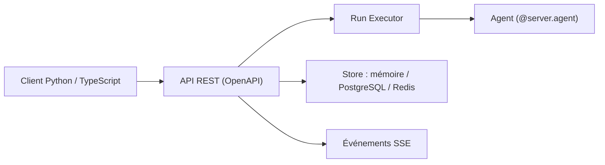

# i-am-bee/acp

> Open REST protocol for communication between agents, now merged into A2A.

## The problem
Agents built in different frameworks cannot talk to each other.

## What it actually does
Defines an OpenAPI specification (agents, runs, sessions, SSE events) and provides a Python SDK (server and client) plus a TypeScript client. Concepts: agent manifest, run, message and multimodal parts, await, sessions. Storage in memory, PostgreSQL or Redis. The README states at the top that ACP is joining A2A under the Linux Foundation.

## How it is wired


## Trying it
```bash
uv init --python '>=3.11' my_acp_project
cd my_acp_project
uv add acp-sdk
uv run agent.py
curl http://localhost:8000/agents
```

## Cost and gotchas
Free, but the repository is archived, last push in August 2025, and replaced by A2A. A migration guide is indicated in the README.

## What it is not
No longer the protocol to adopt: the project itself redirects to A2A.

## Alternatives
A2A (Linux Foundation), cited as the successor in the README.

## For you
Ignore: archived and absorbed by A2A; go straight to A2A for new projects.
