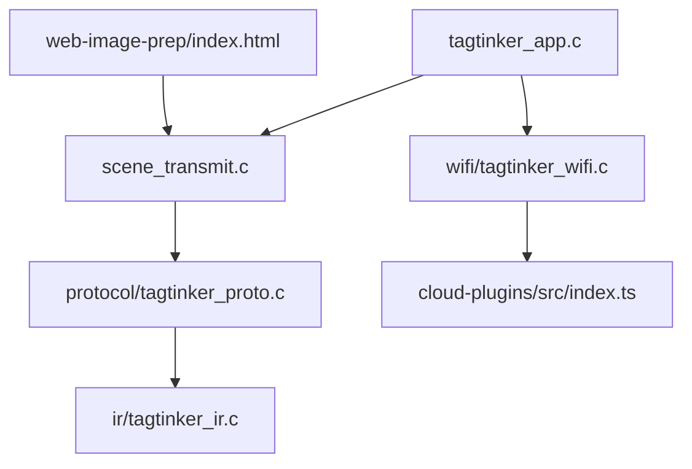

# i12bp8/TagTinker

> Flipper Zero application for studying the infrared protocol of electronic shelf labels.

## The problem
In-store e-ink labels rely on a poorly documented infrared protocol; the security-curious or the artist wants to display text and images on them.

## What it actually does
Transmits text and images over infrared to graphic labels whose type code is known. A web page prepares BMPs (dithering, quantization), and the Flipper also scans NFC to add a target. WiFi option: an ESP32 board and a cloud worker for live designs.

## How it is wired


## Trying it
```bash
make setup
make build-fap
make launch
make serve-web
```

## Cost and gotchas
A Flipper Zero is required; Python 3 and Node 22 for the build. A label whose battery is removed loses its programming and becomes unusable.

## What it is not
Does not work with radio labels (2.4 GHz). The README forbids modifying store labels: legal use on your own hardware.

## Alternatives
- PrecIR (furrtek): reference implementation of the protocol.

## For you
Ignore: research on shelf labels via Flipper Zero, outside your scope, with a risk of illicit use.
