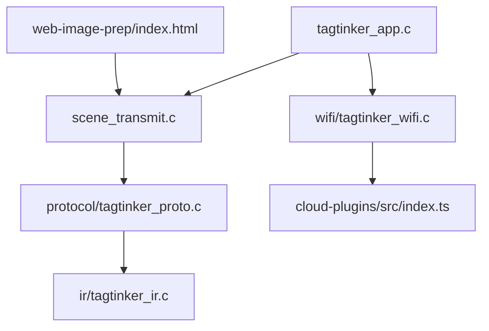

# i12bp8/TagTinker

> Application Flipper Zero pour étudier le protocole infrarouge des étiquettes électroniques de rayon.

## Le problème
Les étiquettes e-ink de magasin reposent sur un protocole infrarouge peu documenté ; le curieux en sécurité ou l'artiste veut y afficher texte et images.

## Ce que ça fait vraiment
Transmet texte et images en infrarouge vers des étiquettes graphiques dont le code de type est connu. Une page web prépare des BMP (dithering, quantification), le Flipper scanne aussi le NFC pour ajouter une cible. Option WiFi : carte ESP32 et worker cloud pour designs en direct.

## Comment c'est branché


## Essayer
```bash
make setup
make build-fap
make launch
make serve-web
```

## Coût et pièges
Il faut un Flipper Zero ; Python 3 et Node 22 pour le build. Une étiquette dont la batterie est retirée perd sa programmation et devient inutilisable.

## Ce que ce n'est pas
Ne fonctionne pas avec les étiquettes radio (2,4 GHz). Le README interdit de modifier les étiquettes de magasins : usage légal sur son propre matériel.

## Alternatives
- PrecIR (furrtek) : implémentation de référence du protocole.

## Pour toi
Ignorer : recherche sur étiquettes de rayon via Flipper Zero, hors de ton périmètre, avec un risque d'usage illicite.

