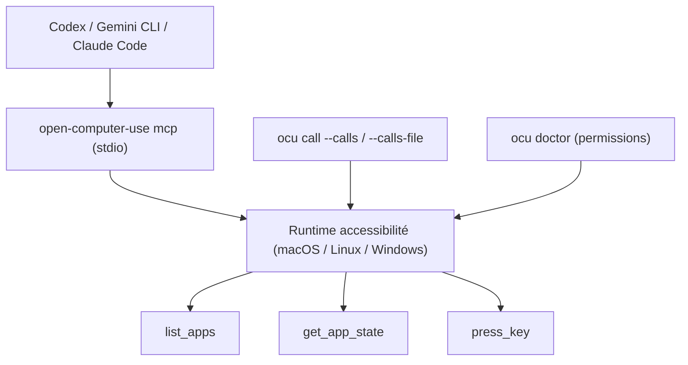

# iFurySt/open-codex-computer-use

> An open source Computer Use service packaged as an MCP server, for macOS, Linux and Windows.

## The problem
Driving a machine's graphical interface from an agent generally requires a proprietary stack or a screenshot interpreted blindly.

## What it actually does
Exposes Computer Use as an MCP server: any agent or MCP client can list applications, read an application's state, press keys, and chain operations. The project is inspired by OpenAI's Codex Computer Use and takes up its principle: a non-intrusive CUA built on accessibility APIs rather than on injection. Built-in installers for Codex (`~/.codex/config.toml`), Claude Code (`~/.claude.json`), Gemini CLI, OpenCode and DeepSeek Harness. An installable skill is also published. A "Cursor Motion" sub-project provides a cursor motion system for macOS.

## How it is wired


## Trying it
```bash
npm i -g open-computer-use
open-computer-use
open-computer-use install-codex-mcp
open-computer-use install-claude-mcp
open-computer-use call list_apps
open-computer-use call get_app_state --args '{"app":"TextEdit"}'
open-computer-use doctor
npx skills add iFurySt/open-codex-computer-use -g -a claude-code --skill open-computer-use -y
```

## Cost and gotchas
Free. On macOS you need macOS 14.0+ and must manually grant the "Accessibility" and "Screen Recording" permissions at first launch; Windows and Linux need neither. Giving an agent control of your machine's keyboard and mouse is a risk in itself: the README offers no sandbox.

## What it is not
It is not an agent: it is the execution organ. Nor is it Browser Use: the README points to `open-browser-use` for that. The author states that the repository comes from his "harness template" and belongs to projects almost entirely generated by AI: worth reading before entrusting it with a workstation.

## Alternatives
- `open-browser-use`, by the same author, if the need is limited to the browser.
- OpenAI's Codex Computer Use, cited as the proprietary inspiration.

## For you
A useful curiosity for automating GUIs without an API; keep it away from a machine that matters.
