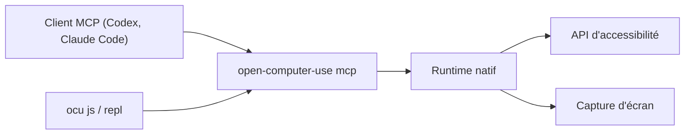

# iFurySt/open-computer-use

> Open-source MCP server that lets an agent drive macOS, Linux or Windows through accessibility.

## The problem
Computer use by agents is mostly offered as a closed product, tied to one client.

## What it actually does
An npm package that exposes nine native tools (`list_apps`, `get_app_state`, `press_key`...) over MCP, plus `query` on macOS. The `open-computer-use` (`ocu`) CLI installs the config in Codex, Claude Code, Gemini CLI, opencode, then lets you call a tool, evaluate JavaScript or launch a REPL. On macOS: Accessibility and Screen Recording permissions.

## How it is wired


## Trying it
```bash
npm i -g open-computer-use
open-computer-use install-codex-mcp
open-computer-use call list_apps
open-computer-use doctor
```

## Cost and gotchas
Free. macOS 14+ and two system permissions. Node 18+ for the launcher. The agent controls the whole machine.

## What it is not
It is not a copy of OpenAI's official product: the README says it is inspired by it. The project is run by a single person and largely AI-generated.

## Alternatives
No alternative named in the README (points to open-browser-use for the browser).

## For you
Watch: a simple MCP building block to try computer control, high risk on a work machine.
