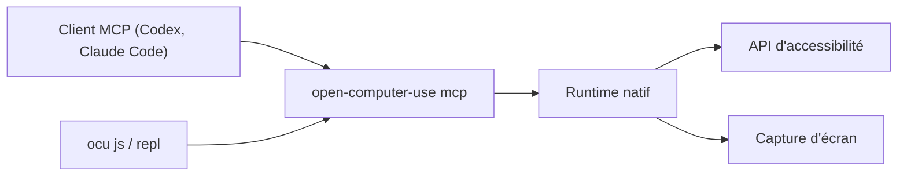

# iFurySt/open-computer-use

> Serveur MCP open source qui laisse un agent piloter macOS, Linux ou Windows par l'accessibilité.

## Le problème
L'utilisation d'ordinateur par agent est surtout proposée en offre fermée, liée à un client.

## Ce que ça fait vraiment
Un paquet npm qui expose neuf outils natifs (`list_apps`, `get_app_state`, `press_key`…) en MCP, plus `query` sur macOS. La CLI `open-computer-use` (`ocu`) installe la config dans Codex, Claude Code, Gemini CLI, opencode, puis permet d'appeler un outil, d'évaluer du JavaScript ou de lancer un REPL. Sous macOS : permissions Accessibilité et Enregistrement d'écran.

## Comment c'est branché


## Essayer
```bash
npm i -g open-computer-use
open-computer-use install-codex-mcp
open-computer-use call list_apps
open-computer-use doctor
```

## Coût et pièges
Gratuit. macOS 14+ et deux permissions système. Node 18+ pour le lanceur. L'agent pilote tout le poste.

## Ce que ce n'est pas
Ce n'est pas une copie officielle du produit d'OpenAI : le README dit en être inspiré. Le projet est mené par une seule personne et largement généré par IA.

## Alternatives
Aucune alternative nommée dans le README (renvoie vers open-browser-use pour le navigateur).

## Pour toi
À surveiller : brique MCP simple pour tester le contrôle d'ordinateur, risque élevé sur une machine de travail.

