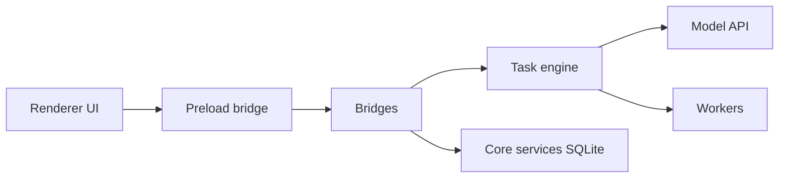

# iOfficeAI/AionUi

> Desktop application and WebUI that federates a built-in agent and CLI agents (Claude Code, Codex…) for office work.

## The problem
Each CLI agent has its own interface, with no preview of the files produced and no scheduled automation.

## What it actually does
Provides a built-in agent (aionrs engine) with file read/write, web search, MCP and 21 predefined assistants (PPT, Word, Excel…). Detects installed CLI agents, launches parallel sessions and a leader/teammates team mode. Preview of 10+ formats, scheduled tasks (cron), remote access via WebUI or Telegram, Lark, DingTalk, WeChat. Local data in SQLite.

## How it is wired


## Trying it
```bash
brew install aionui
```
Otherwise: installer from the Releases page, then enter an API key.

## Cost and gotchas
The application is free; the provider's API usage is at your expense. 4 GB of RAM recommended. Local development requires two repositories (AionUi and AionCore). 882 open issues.

## What it is not
Not a model or a cloud service: the agent has full file access on your machine, with confirmation. The comparison with Claude Cowork comes from the README itself.

## Alternatives
Claude Cowork (macOS only, Claude only, according to the README).

## For you
Worth watching: handy for grouping several agents behind a single interface and generating documents, but for data pipelines you will be more comfortable in a pure CLI.
