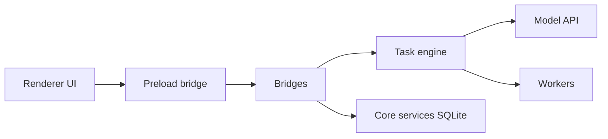

# iOfficeAI/AionUi

> Application de bureau et WebUI qui fédère un agent intégré et des agents CLI (Claude Code, Codex…) pour le travail bureautique.

## Le problème
Chaque agent CLI a sa propre interface, sans aperçu des fichiers produits ni automatisation planifiée.

## Ce que ça fait vraiment
Fournit un agent intégré (moteur aionrs) avec lecture/écriture de fichiers, recherche web, MCP et 21 assistants prédéfinis (PPT, Word, Excel…). Détecte les agents CLI installés, lance des sessions parallèles et un mode équipe leader/teammates. Aperçu de 10+ formats, tâches planifiées (cron), accès distant par WebUI ou Telegram, Lark, DingTalk, WeChat. Données locales en SQLite.

## Comment c'est branché


## Essayer
```bash
brew install aionui
```
Sinon : installeur depuis la page Releases, puis saisir une clé d'API.

## Coût et pièges
Application gratuite ; l'usage API du fournisseur est à ta charge. 4 Go de RAM recommandés. Le développement local demande deux dépôts (AionUi et AionCore). 882 issues ouvertes.

## Ce que ce n'est pas
Pas un modèle ni un service cloud : l'agent a un accès fichiers complet sur ta machine, avec validation. La comparaison avec Claude Cowork vient du README lui-même.

## Alternatives
Claude Cowork (macOS seulement, Claude seul, selon le README).

## Pour toi
À surveiller : pratique pour regrouper plusieurs agents derrière une interface unique et générer des documents, mais pour des pipelines data tu seras plus à l'aise en CLI pur.

