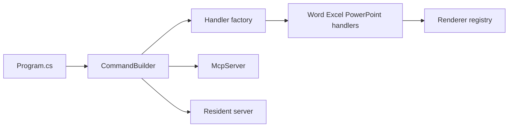

# iOfficeAI/OfficeCLI

> Standalone CLI to create, read, edit and render Word, Excel and PowerPoint files, designed for AI agents.

## The problem
Manipulating .docx/.xlsx/.pptx files in code requires several libraries and an Office installation to see the result.

## What it actually does
A single binary (embedded .NET runtime): `create`, `view`, `get`, `query`, `set`, `add`, `remove`, `batch`, `merge` (`{{key}}` templates), `dump`. JSON output, path-based addressing (`/slide[1]/shape[1]`), fallback to raw XML. Built-in HTML/PNG rendering engine, calculation of 350+ Excel functions, pivot tables, MCP server, resident mode, Python and Node SDKs.

## How it is wired


## Trying it
```bash
officecli create deck.pptx
officecli add deck.pptx / --type slide --prop title="Hello, World!"
officecli view deck.pptx outline
officecli watch deck.pptx
```
Installation: `brew install officecli` or `npm install -g @officecli/officecli`.

## Cost and gotchas
Free. Automatic background update (can be disabled with `officecli config autoUpdate false`). Do not read the file from another tool before `save` in resident mode. PNG captures go through a headless browser.

## What it is not
Not Microsoft Office: rendering is a homegrown engine, faithful according to the README but not identical. .doc or PDF formats go through plugins.

## Alternatives
python-docx / openpyxl, LibreOffice, Microsoft Office (compared in the README).

## For you
Adopt it to automate the generation of reports or decks from data or an agent: Apache-2.0 license, single binary, deterministic JSON.
