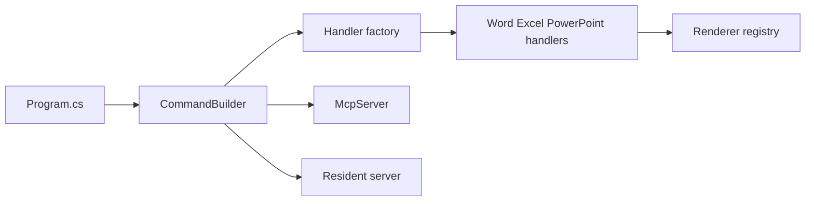

# iOfficeAI/OfficeCLI

> CLI autonome pour créer, lire, modifier et rendre des fichiers Word, Excel et PowerPoint, pensé pour les agents IA.

## Le problème
Manipuler des .docx/.xlsx/.pptx par code demande plusieurs bibliothèques et une installation d'Office pour voir le résultat.

## Ce que ça fait vraiment
Un binaire unique (runtime .NET embarqué) : `create`, `view`, `get`, `query`, `set`, `add`, `remove`, `batch`, `merge` (gabarits `{{clé}}`), `dump`. Sortie JSON, adressage par chemins (`/slide[1]/shape[1]`), repli en XML brut. Moteur de rendu HTML/PNG intégré, calcul de 350+ fonctions Excel, tableaux croisés dynamiques, serveur MCP, mode résident, SDK Python et Node.

## Comment c'est branché


## Essayer
```bash
officecli create deck.pptx
officecli add deck.pptx / --type slide --prop title="Hello, World!"
officecli view deck.pptx outline
officecli watch deck.pptx
```
Installation : `brew install officecli` ou `npm install -g @officecli/officecli`.

## Coût et pièges
Gratuit. Mise à jour automatique en arrière-plan (désactivable avec `officecli config autoUpdate false`). Ne lit pas le fichier depuis un autre outil avant `save` en mode résident. Les captures PNG passent par un navigateur headless.

## Ce que ce n'est pas
Pas Microsoft Office : le rendu est un moteur maison, fidèle selon le README mais pas identique. Les formats .doc ou PDF passent par des plugins.

## Alternatives
python-docx / openpyxl, LibreOffice, Microsoft Office (comparés dans le README).

## Pour toi
À adopter pour automatiser la génération de rapports ou de decks depuis des données ou un agent : licence Apache-2.0, binaire unique, JSON déterministe.

