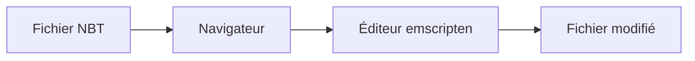

# iRath96/webNBT

> HTML5 NBT editor based on emscripten for editing Minecraft files in the browser.

## The problem
Editing Minecraft NBT files usually requires software to download.

## What it actually does
Web editor compiled with emscripten; an online demo is mentioned. The README documents nothing else.

## How it is wired

## Trying it
No command documented: use the online demo mentioned.

## Cost and gotchas
Free. License not declared, last push April 2022.

## What it is not
Not a data or AI tool: it is a web editor compiled with emscripten, whose README documents nothing but an online demo.

## Alternatives
No alternative named in the README.

## For you
Ignore: unrelated to your profile, old and unlicensed.
