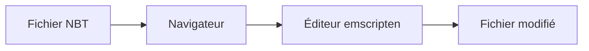

# iRath96/webNBT

> Éditeur NBT HTML5 basé sur emscripten pour modifier des fichiers Minecraft dans le navigateur.

## Le problème
Modifier les fichiers NBT de Minecraft demande d'ordinaire un logiciel à télécharger.

## Ce que ça fait vraiment
Éditeur web compilé avec emscripten ; une démo en ligne est mentionnée. Le README ne documente rien d'autre.

## Comment c'est branché

## Essayer
Aucune commande documentée : utiliser la démo en ligne mentionnée.

## Coût et pièges
Gratuit. Licence non déclarée, dernier push avril 2022.

## Ce que ce n'est pas
Pas un outil data ni IA : c'est un éditeur web compilé avec emscripten, dont le README ne documente rien d'autre qu'une démo en ligne.

## Alternatives
Aucune alternative nommée dans le README.

## Pour toi
À ignorer : sans rapport avec ton profil, ancien et sans licence.

