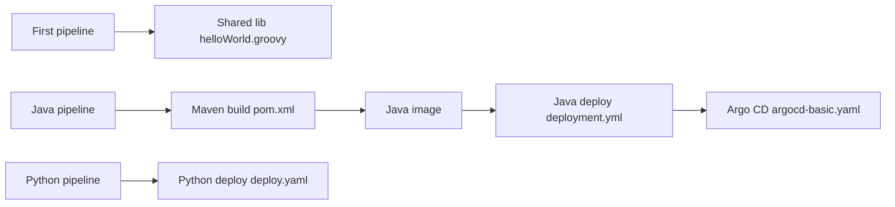

# iam-veeramalla/Jenkins-Zero-To-Hero

> Jenkins tutorial: installation on EC2, Docker agent, CI/CD pipelines to Kubernetes and Argo CD.

## The problem
Getting started with Jenkins and building a first end-to-end pipeline is confusing for a DevOps beginner.

## What it actually does
The README walks through installing Java and Jenkins on Ubuntu/EC2, opening port 8080, the Docker Pipeline plugin and Docker permissions.
The repository contains independent examples: simple and multi-agent pipelines, a shared library, a Spring Boot app (Maven, Sonar, Helm) and a Django todo app.
Kubernetes manifests and Argo CD configuration to illustrate GitOps.

## How it is wired


## Trying it
```bash
sudo apt update
sudo apt install openjdk-17-jre
sudo apt-get install jenkins
sudo apt install docker.io
```

## Cost and gotchas
AWS account and EC2 instance are on you. The README opens "All traffic" inbound in its example: restrict it to port 8080. Last push March 2025.

## What it is not
Not a product or a tool: course material accompanying YouTube videos. Not a security best-practices reference.

## Alternatives
None named in the README.

## For you
Ignore: educational for getting started with Jenkins CI, but your MLOps pipelines will more likely run on GitHub Actions or GitLab CI.
