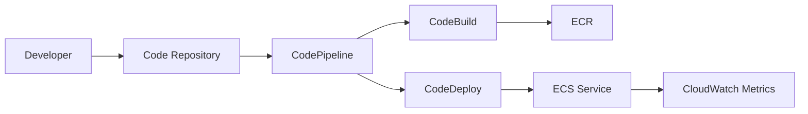

# iam-veeramalla/aws-devops-zero-to-hero

> 30-day course to learn AWS from a DevOps angle, with projects and interview questions.

## The problem
AWS has hundreds of services; a DevOps beginner doesn't know in what order to learn them or how to connect them.

## What it actually does
One day per topic: IAM, EC2, VPC, security, Route 53, S3, CLI, CloudFormation, CodeCommit/Pipeline/Build/Deploy, CloudWatch, Lambda, ECR, ECS, EKS, Secrets Manager, Terraform, CloudTrail, ELB, RDS.
Hands-on projects (secure VPC, CI/CD pipeline, Blue/Green deployment…) and example files in each `day-N` folder.
List of AWS interview questions.
Accompanied by a YouTube playlist.

## How it is wired

## Trying it
No command in the README: it is a course plan.

## Cost and gotchas
An AWS account is required; the projects (NAT gateway, EKS, RDS) can generate a bill if resources are not destroyed.

## What it is not
Not a tool nor a reusable infrastructure template.
Content not updated since mid-2025; day 23 announces Systems Manager but covers Secrets Manager.

## Alternatives
No alternative named in the README.

## For you
Ignore unless you need basic AWS training: no ML-specific content, and SageMaker is not covered.
