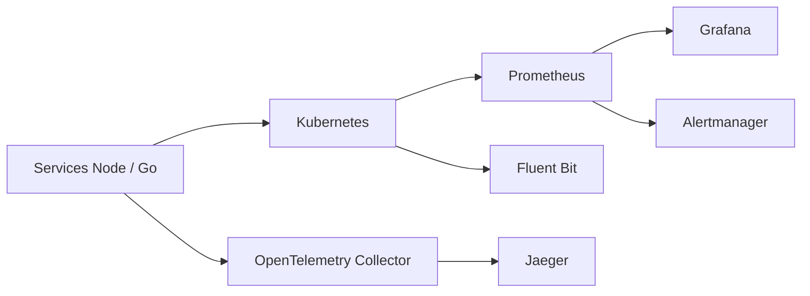

# iam-veeramalla/observability-zero-to-hero

> Seven-day tutorial on Kubernetes observability: Prometheus, Grafana, EFK, Jaeger, OpenTelemetry.

## The problem
Learning metrics, logs and traces on Kubernetes without finding a hands-on path that ties the tools together.

## What it actually does
Seven `day-*` folders: intro, Prometheus + Grafana (kube-prometheus-stack via Helm, on EKS), PromQL, custom metrics with `prom-client` (Node services `service-a`/`service-b`) and Alertmanager, logs with Fluent Bit (OpenSearch variant), Jaeger traces, then OpenTelemetry Collector with two Go microservices. Each day is a nearly independent module, with manifests and Helm values.

## How it is wired

## Trying it
The README gives no command: it describes the content of each day. The commands are in the `day-*` folders (not read here).

## Cost and gotchas
A Kubernetes cluster (EKS in the examples) is required and may be billed. No license declared. The Day 5 README is truncated.

## What it is not
Not a tool or a product: course material. Does not cover model- or LLM-specific observability.

## Alternatives
Not documented in the README.

## For you
Watch: a good path for the observability layer of an MLOps profile, if you already have a test cluster; with no license, do not reuse the content as is.
