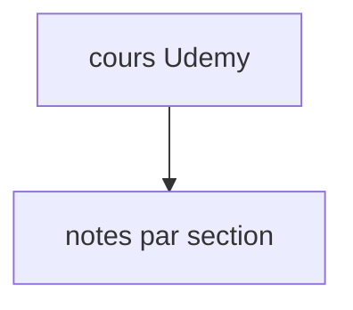

# iam-veeramalla/ultimate-devops-project-aws

> Notes from an Abhishek Veeramalla DevOps Udemy course, organized by video section.

## The problem
Following a video course without written notes forces you to rewatch everything to find a command.

## What it actually does
Repository of notes organized like the course sections. The content is not described in the README: not documented.

## How it is wired

## Trying it
No command documented. Read the section folders.

## Cost and gotchas
The Udemy course is paid; the notes alone are free. Last push in February 2025.

## What it is not
Not an executable project, nor a complete course: it is a complement to a video.

## Alternatives
No alternative named in the README.

## For you
Ignore: companion notes with no verifiable content here, and not updated for over a year.
