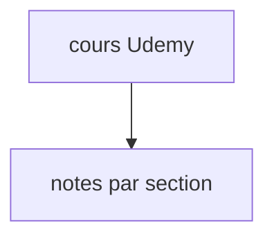

# iam-veeramalla/ultimate-devops-project-aws

> Notes d'un cours Udemy DevOps d'Abhishek Veeramalla, rangées par section de vidéo.

## Le problème
Suivre un cours vidéo sans notes écrites oblige à tout revoir pour retrouver une commande.

## Ce que ça fait vraiment
Dépôt de notes organisées comme les sections du cours. Le contenu n'est pas décrit dans le README : non documenté.

## Comment c'est branché

## Essayer
Aucune commande documentée. Lire les dossiers de sections.

## Coût et pièges
Le cours Udemy est payant ; les notes seules sont gratuites. Dernier push en février 2025.

## Ce que ce n'est pas
Pas un projet exécutable, ni un cours complet : c'est un complément à une vidéo.

## Alternatives
Aucune alternative nommée dans le README.

## Pour toi
À ignorer : notes d'accompagnement sans contenu vérifiable ici, et sans mise à jour depuis plus d'un an.

