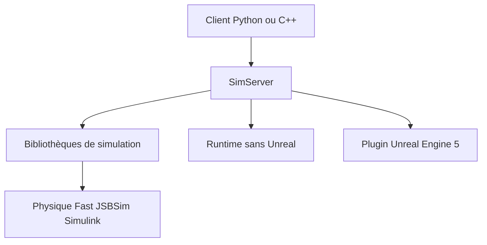

# iamaisim/ProjectAirSim

> Open source simulation platform for drones and autonomous vehicles, with or without Unreal Engine.

## The problem
Testing a controller or autonomy on a real drone is costly and risky.

## What it actually does
Three layers: simulation libraries (robots, physics, controllers, sensors), host (lightweight Runtime without Unreal, or Unreal Engine 5 plugin with rendering), and Python and C++ client libraries or a ROS 2 bridge. Fast C++ physics, JSBSim or Simulink; PX4, ArduPilot and sensors (camera, LiDAR, radar, IMU, GPS). Taken over by IAMAI after Microsoft discontinued the project.

## How it is wired

Simplified diagram based on the sheet, no diagram provided.

## Trying it
```bash
export UE_ROOT=/path/to/UnrealEngine
./setup_linux_dev_tools.sh
./build.sh simlibs_debug
./blocks_genprojfiles_vscode.sh
```

## Cost and gotchas
Free. Heavy build: Unreal Engine 5.2, 5.7 or 5.8, GPU for rendering. The Runtime has no camera, LiDAR or radar. The Unity integration is not maintained. IAMAI sells professional services.

## What it is not
Not a turnkey simulator without Unreal for perception: without it, no rendered sensors. Published binaries may lag behind the main branch.

## Alternatives
- Microsoft's AirSim: the ancestor, of which this project is the evolution.

## For you
Watch: testbed for reinforcement learning and drone perception, with a Python API, if you have a GPU and time for the setup.
