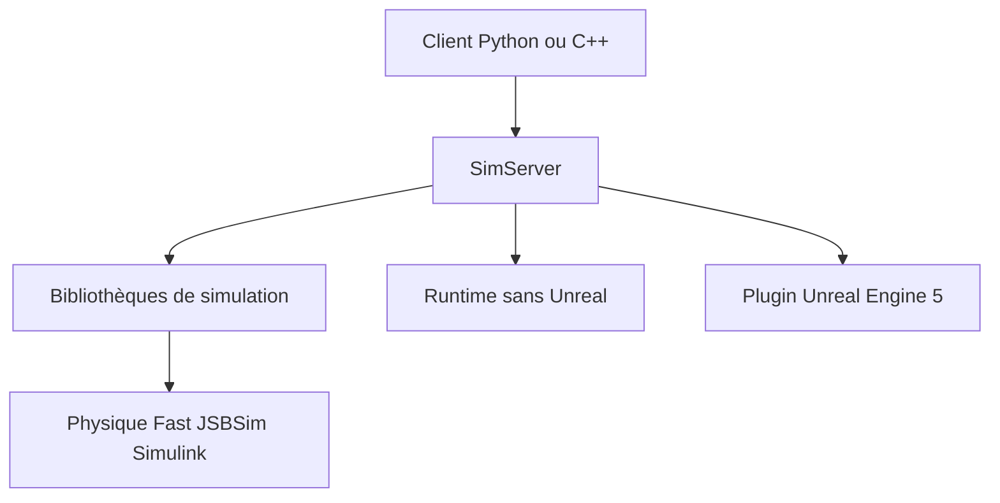

# iamaisim/ProjectAirSim

> Plateforme de simulation open source pour drones et véhicules autonomes, avec ou sans Unreal Engine.

## Le problème
Tester un contrôleur ou une autonomie sur un vrai drone est coûteux et risqué.

## Ce que ça fait vraiment
Trois couches : bibliothèques de simulation (robots, physique, contrôleurs, capteurs), hôte (Runtime léger sans Unreal, ou plugin Unreal Engine 5 avec rendu), et bibliothèques client Python et C++ ou pont ROS 2. Physique rapide C++, JSBSim ou Simulink ; PX4, ArduPilot et capteurs (caméra, LiDAR, radar, IMU, GPS). Reprise par IAMAI après l'arrêt du projet par Microsoft.

## Comment c'est branché

Schéma simplifié d'après la fiche, sans diagramme fourni.

## Essayer
```bash
export UE_ROOT=/path/to/UnrealEngine
./setup_linux_dev_tools.sh
./build.sh simlibs_debug
./blocks_genprojfiles_vscode.sh
```

## Coût et pièges
Gratuit. Construction lourde : Unreal Engine 5.2, 5.7 ou 5.8, GPU pour le rendu. Le Runtime n'a ni caméra, ni LiDAR, ni radar. L'intégration Unity n'est pas maintenue. IAMAI vend des services professionnels.

## Ce que ce n'est pas
Pas un simulateur clé en main sans Unreal pour la perception : sans lui, pas de capteurs rendus. Les binaires publiés peuvent retarder sur la branche principale.

## Alternatives
- AirSim de Microsoft : l'ancêtre, dont ce projet est l'évolution.

## Pour toi
Surveiller : terrain d'essai pour apprentissage par renforcement et perception de drones, avec API Python, si tu as un GPU et du temps de mise en place.

