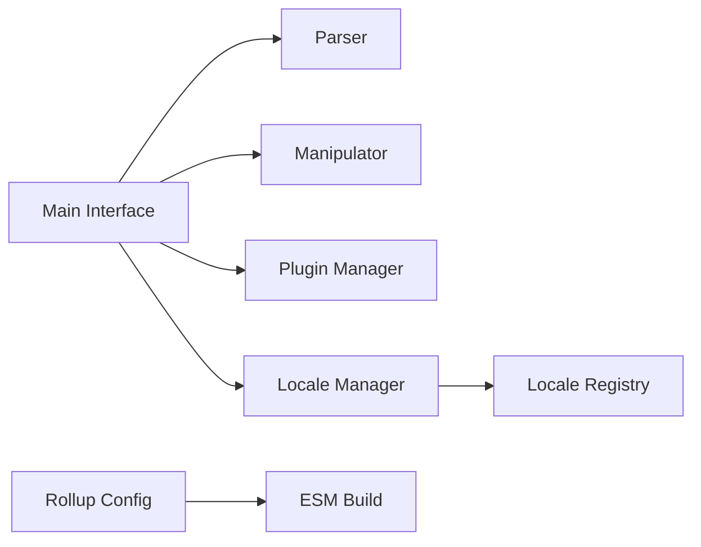

# iamkun/dayjs

> Minimalist JavaScript date library, with an API close to Moment.js, for modern browsers.

## The problem
Handling dates and time zones in plain JavaScript is painful, and Moment.js is heavy.

## What it actually does
It parses, validates, manipulates and formats dates with a chainable, immutable API, for example `dayjs().add(1, 'year')`. Locales and plugins (advancedFormat, timezone, utc, duration…) are loaded on demand and are not included in the build without an import. The README claims about 2 kB.

## How it is wired

The architecture text is a drawing guide, and the modules in it are inferred.

## Trying it
```bash
npm install dayjs --save
```

## Cost and gotchas
Free. Plugins and locales must be imported explicitly; otherwise the corresponding functions are missing. 1,329 open issues.

## What it is not
It is not a complete copy of Moment.js: only the core API is compatible, the rest goes through plugins. It does not cover Python nor data-side dates.

## Alternatives
- moment/moment: keep only for existing code, it is in maintenance mode.

## For you
Adopt if you write JavaScript (MLOps dashboards): it replaces Moment with the same style and a reduced weight.
