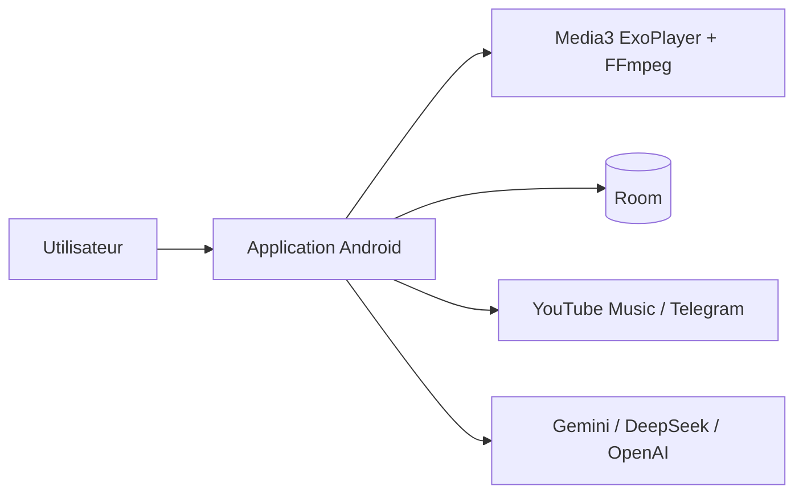

# ianshulyadav/PixelMusic

> Android music player that brings together local files, YouTube Music and Telegram, with AI playlists.

## The problem
Listening to your files, YouTube Music and Telegram means juggling several applications.

## What it actually does
Kotlin and Jetpack Compose application with lossless playback (FLAC, ALAC, WAV, APE), 10-band equalizer, synced lyrics (LRCLIB), Android Auto, Chromecast, Last.fm scrobbling. AI playlists go through Gemini, DeepSeek or OpenAI with your own keys. It is an unofficial fork of PixelPlayerOSS.

## How it is wired
Simplified diagram based on the sheet, no diagram provided.


## Trying it
```bash
git clone https://github.com/ianshulyadav/PixelMusicApp.git
cd PixelMusicApp
./gradlew :app:assembleDebug
```

## Cost and gotchas
Free; Gemini or DeepSeek keys go in `local.properties` for the AI features. JDK 21 required to build. The YouTube and Telegram integrations are unofficial.

## What it is not
Not a data or AI tool: AI is only used to compose playlists. Third-party integrations may break and violate their terms of use.

## Alternatives
PixelPlayerOSS, of which this is a fork, is the upstream project cited in the README.

## For you
Ignore: an Android music player unrelated to your field, and a fork of an older project.
