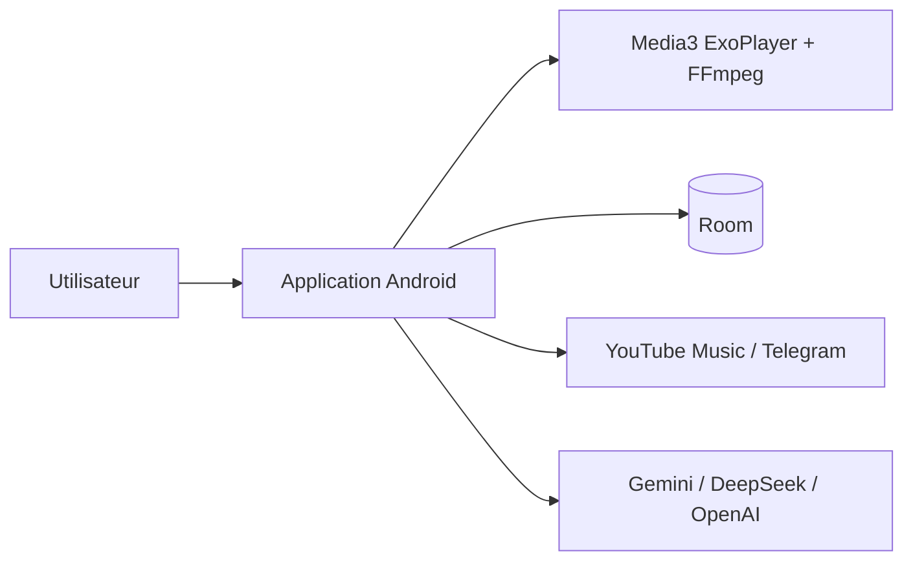

# ianshulyadav/PixelMusic

> Lecteur de musique Android qui réunit fichiers locaux, YouTube Music et Telegram, avec playlists par IA.

## Le problème
Écouter ses fichiers, YouTube Music et Telegram oblige à jongler entre plusieurs applications.

## Ce que ça fait vraiment
Application Kotlin et Jetpack Compose avec lecture sans perte (FLAC, ALAC, WAV, APE), égaliseur 10 bandes, paroles synchronisées (LRCLIB), Android Auto, Chromecast, scrobbling Last.fm. Les playlists IA passent par Gemini, DeepSeek ou OpenAI avec tes propres clés. C'est un fork non officiel de PixelPlayerOSS.

## Comment c'est branché
Schéma simplifié d'après la fiche, sans diagramme fourni.


## Essayer
```bash
git clone https://github.com/ianshulyadav/PixelMusicApp.git
cd PixelMusicApp
./gradlew :app:assembleDebug
```

## Coût et pièges
Gratuit ; les clés Gemini ou DeepSeek sont à mettre dans `local.properties` pour les fonctions IA. JDK 21 requis pour compiler. Les intégrations YouTube et Telegram sont non officielles.

## Ce que ce n'est pas
Ce n'est pas un outil de data ou d'IA : l'IA ne sert qu'à composer des playlists. Les intégrations tierces peuvent casser et violer leurs conditions d'usage.

## Alternatives
PixelPlayerOSS, dont c'est un fork, est le projet amont cité dans le README.

## Pour toi
À ignorer : lecteur musical Android sans lien avec ton métier, et fork d'un projet plus ancien.

