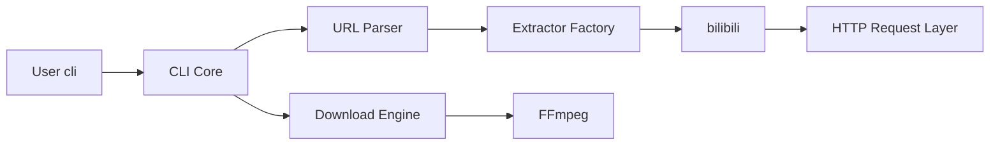

# iawia002/lux

> Command-line video downloader written in Go, multi-site.

## The problem
Fetching a video or playlist from YouTube, Bilibili and other sites requires one tool per platform.

## What it actually does
One extractor per site behind a common interface; URL parser that picks the extractor.
Multi-threaded download, resume, retry, cookies, proxy, playlists, subtitles, JSON output (`-j`).
Fragments merged via FFmpeg; download possible via aria2 RPC.

## How it is wired


## Trying it
```bash
go install github.com/iawia002/lux@latest
brew install lux
lux -i "https://www.youtube.com/watch?v=dQw4w9WgXcQ"
```

## Cost and gotchas
FFmpeg required for merging. Some sites (Youku, Xigua) break often and require up-to-date cookies.

## What it is not
Not a video dataset library; coverage centered on Chinese sites.

## Alternatives
- youtube-dl: broader site coverage.
- you-get: another multi-site downloader.
- ytdl: cited as a similar project.

## For you
Out of scope; to collect videos, a broader tool exists.
