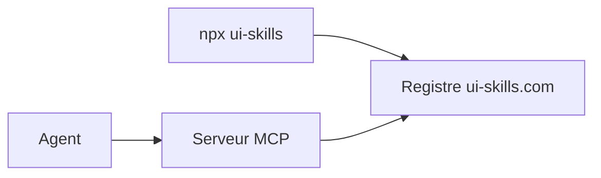

# ibelick/ui-skills

> Skills registry for design engineers, accessible via CLI or MCP server.

## The problem
UI skills are scattered; an agent struggles to find and fetch them at the right moment.

## What it actually does
Minimal README (under 800 characters). A CLI (`ui-skills`) to get started, list categories, list by category and fetch a skill; a remote MCP server with two tools, `list_skills` and `get_skill`. A "playbook" of UI lessons is referred to the website. The rest is undocumented.

## How it is wired


## Trying it
```bash
npx ui-skills start
npx ui-skills categories
npx ui-skills list --category motion
npx ui-skills get baseline-ui
```

## Cost and gotchas
Not documented. The MCP server is hosted on ui-skills.com: the registry depends on that service.

## What it is not
Not a set of skills in the repository: the content lives on the website. Minimal sheet for lack of material.

## Alternatives
No alternative named in the README.

## For you
Watch: too little documented to decide; with no link to your data/AI work, look at it only if you do interface work.
