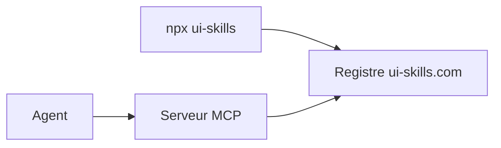

# ibelick/ui-skills

> Registre de skills pour ingénieurs design, consultable par CLI ou serveur MCP.

## Le problème
Les skills d'interface sont dispersés ; un agent a du mal à les trouver et à les récupérer au bon moment.

## Ce que ça fait vraiment
README minimal (moins de 800 caractères). Un CLI (`ui-skills`) pour démarrer, lister les catégories, lister par catégorie et récupérer un skill ; un serveur MCP distant avec deux outils, `list_skills` et `get_skill`. Un « playbook » de leçons d'UI est renvoyé vers le site. Le reste est non documenté.

## Comment c'est branché


## Essayer
```bash
npx ui-skills start
npx ui-skills categories
npx ui-skills list --category motion
npx ui-skills get baseline-ui
```

## Coût et pièges
Non documenté. Le serveur MCP est hébergé sur ui-skills.com : le registre dépend de ce service.

## Ce que ce n'est pas
Pas un lot de skills dans le dépôt : le contenu vit sur le site. Fiche minimale faute de matière.

## Alternatives
Aucune alternative nommée dans le README.

## Pour toi
À surveiller : trop peu documenté pour trancher ; sans lien avec ton travail data/IA, regarde-le seulement si tu fais de l'interface.

