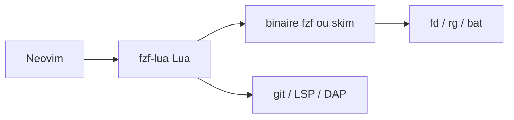

# ibhagwan/fzf-lua

> Neovim plugin exposing fzf to search files, text, git, LSP and more, for Neovim users.

## The problem
Navigating a large project from the editor requires fast fuzzy pickers over files, buffers, symbols and git history.

## What it actually does
Provides dozens of commands (files, grep, live_grep, buffers, git_*, lsp_*, diagnostics, DAP, tmux, zoxide) through the fzf binary, with built-in preview, customizable actions, predefined profiles (telescope, fzf-vim, ivy, max-perf) and insert-mode completion.

## How it is wired


## Trying it
```bash
sh -c "$(curl -s https://raw.githubusercontent.com/ibhagwan/fzf-lua/main/scripts/mini.sh)"
```
```lua
:FzfLua files
:FzfLua live_grep
```

## Cost and gotchas
Free. Requires Neovim 0.9 or later and fzf above 0.36. Running a curl script without reading it is discouraged by the README itself. On Windows, rg is mandatory for grep.

## What it is not
Not an editor nor a replacement for fzf: a Neovim interface on top. Nothing runs outside Neovim.

## Alternatives
- fzf.vim: the fzf-vim profile brings it closer.
- telescope.nvim: the telescope profile imitates its look.

## For you
Worth watching: excellent if you code in Neovim, useless otherwise, with no direct link to data/AI tools.
