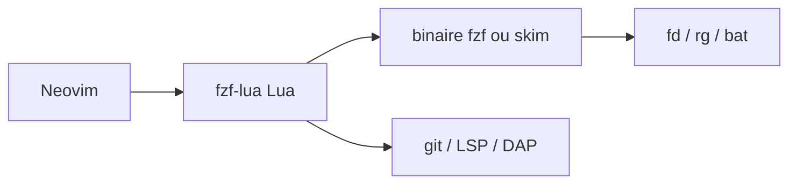

# ibhagwan/fzf-lua

> Plugin Neovim qui expose fzf pour chercher fichiers, texte, git, LSP et plus, pour utilisateurs de Neovim.

## Le problème
Naviguer dans un gros projet depuis l'éditeur exige des sélecteurs flous rapides sur fichiers, tampons, symboles et historique git.

## Ce que ça fait vraiment
Fournit des dizaines de commandes (files, grep, live_grep, buffers, git_*, lsp_*, diagnostics, DAP, tmux, zoxide) via le binaire fzf, avec prévisualisation intégrée, actions personnalisables, profils prédéfinis (telescope, fzf-vim, ivy, max-perf) et complétion en mode insertion.

## Comment c'est branché


## Essayer
```bash
sh -c "$(curl -s https://raw.githubusercontent.com/ibhagwan/fzf-lua/main/scripts/mini.sh)"
```
```lua
:FzfLua files
:FzfLua live_grep
```

## Coût et pièges
Gratuit. Requiert Neovim 0.9 ou plus et fzf supérieur à 0.36. Lancer un script curl sans le lire est déconseillé par le README lui-même. Sous Windows, rg est obligatoire pour grep.

## Ce que ce n'est pas
Pas un éditeur ni un remplaçant de fzf : une interface Neovim au-dessus. Rien ne tourne hors de Neovim.

## Alternatives
- fzf.vim : profil fzf-vim pour s'en rapprocher.
- telescope.nvim : profil telescope qui imite son rendu.

## Pour toi
Surveiller : excellent si tu codes sous Neovim, inutile sinon, sans lien direct avec les outils data/IA.

