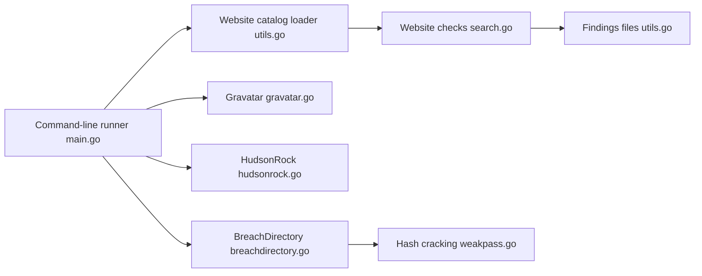

# ibnaleem/gosearch

> OSINT tool in Go that searches for a username across many sites and in leak databases.

## The problem
Manually checking whether a username exists on hundreds of sites is slow, and the reference tool (Sherlock) gives false positives and negatives according to the author.

## What it actually does
The binary reads a catalog of sites, tests profiles concurrently, then enriches: GitHub, Gravatar, Keybase, domains under common TLDs. It also queries the HudsonRock, ProxyNova leak APIs and, with a key, BreachDirectory; the password hashes found are submitted to Weakpass. Uncertain results are colored yellow; `--no-false-positives` keeps only the sure profiles. Results are saved to files.

## How it is wired


## Trying it
```bash
go install github.com/ibnaleem/gosearch@latest
gosearch -u [username]
gosearch -u [USERNAME] --no-false-positives
gosearch -u [USERNAME] -b [API-KEY] --no-false-positives
```

## Cost and gotchas
Free, but BreachDirectory requires an API key. Depends on third-party APIs. Windows Defender may flag the binary by mistake (cited issue); on 32-bit, use the indicated branch. Download only from this repository.

## What it is not
Neither a compliance tool nor a monitoring service: it aggregates personal data and leaks, so it is subject to GDPR and local law. Legitimate use: authorized investigation, auditing your own exposure. The README claims a cracking success rate "close to 100%", a claim not verified here.

## Alternatives
- Sherlock: the cited reference, in Python, compared unfavorably by the author.
- urbanadventurer/username-anarchy: generates usernames to test, a complement rather than an alternative.

## For you
Watch: without a legally supervised OSINT mission, it brings nothing to a data/AI/MLOps profile, and it handles sensitive data.
