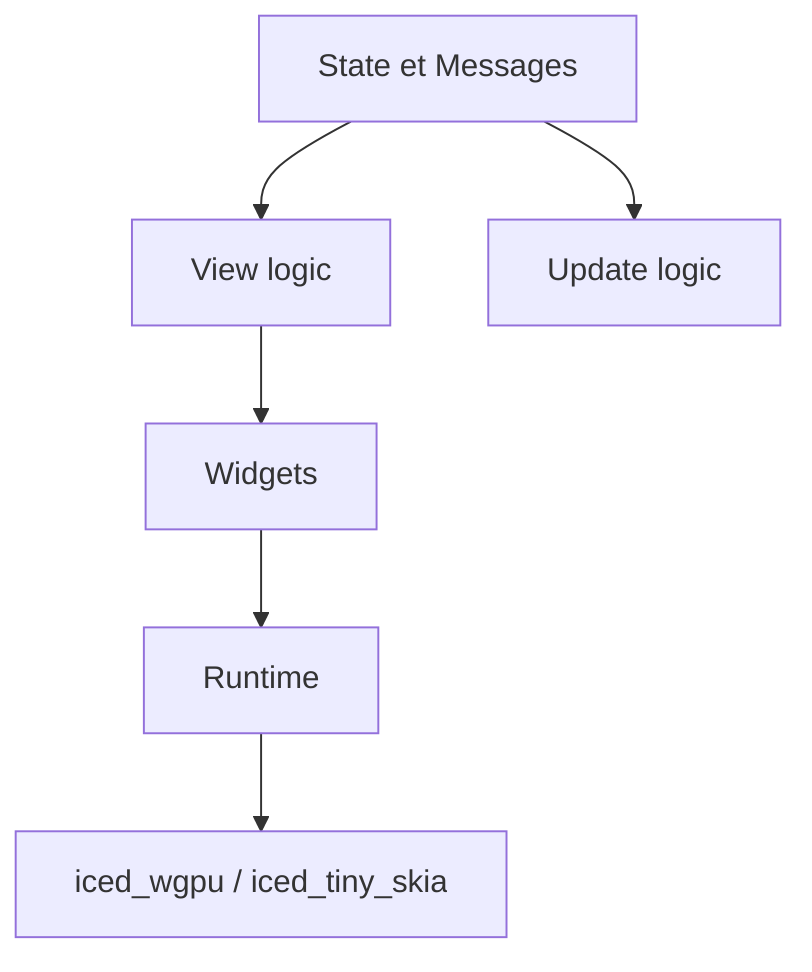

# iced-rs/iced

> Cross-platform Rust GUI library, inspired by Elm, for Rust developers.

## The problem
Writing a graphical interface in Rust with a clear, type-safe architecture, without depending on a C++ toolkit.

## What it actually does
Reactive model with four concepts (state, messages, view, update). Built-in widgets, custom widgets, responsive layout, async actions and debugging tools (metrics, time travel). Two rendering engines: `iced_wgpu` (Vulkan, Metal, DX12) and `iced_tiny_skia` as a software fallback. Targets: Windows, macOS, Linux and Web. The README declares itself "experimental".

## How it is wired


## Trying it
```bash
# le README fournit un exemple de compteur en Rust :
# fn main() -> iced::Result { iced::run(Counter::update, Counter::view) }
```

## Cost and gotchas
Free. Requires Rust; the API evolves (experimental project).

## What it is not
Not a visualization tool nor a data dashboard tool. No link with Python.

## Alternatives
No alternative mentioned in the README.

## For you
Ignore: a Rust UI library, far from the data/AI scope; for dashboards, Streamlit or Gradio are enough.
