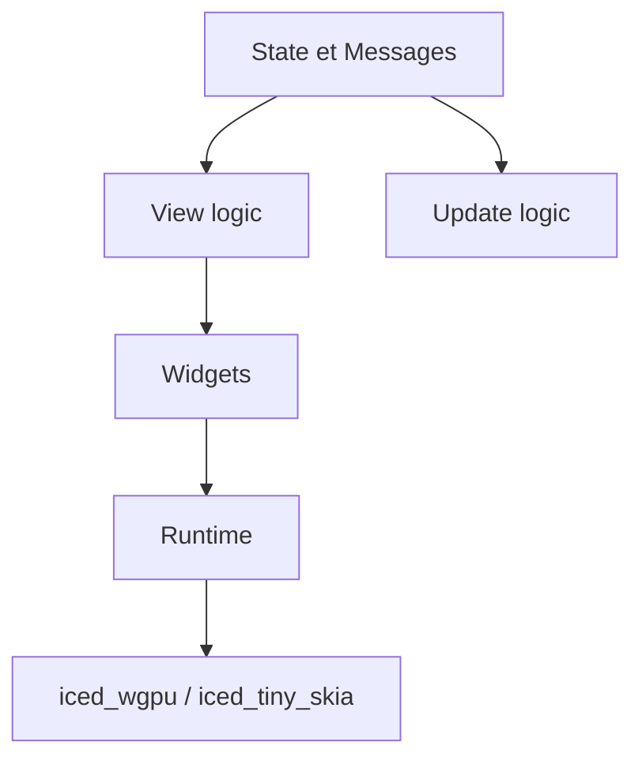

# iced-rs/iced

> Bibliothèque d'interfaces graphiques Rust multiplateforme, inspirée d'Elm, pour développeurs Rust.

## Le problème
Écrire une interface graphique en Rust avec une architecture claire et sûre côté types, sans dépendre d'un toolkit C++.

## Ce que ça fait vraiment
Modèle réactif en quatre concepts (état, messages, vue, mise à jour). Widgets intégrés, widgets personnalisés, mise en page adaptative, actions asynchrones et outils de débogage (métriques, voyage dans le temps). Deux moteurs de rendu : `iced_wgpu` (Vulkan, Metal, DX12) et `iced_tiny_skia` en secours logiciel. Cibles : Windows, macOS, Linux et Web. Le README se déclare « expérimental ».

## Comment c'est branché


## Essayer
```bash
# le README fournit un exemple de compteur en Rust :
# fn main() -> iced::Result { iced::run(Counter::update, Counter::view) }
```

## Coût et pièges
Gratuit. Il faut du Rust ; l'API évolue (projet expérimental).

## Ce que ce n'est pas
Pas un outil de visualisation ni de tableaux de bord de données. Pas de lien avec Python.

## Alternatives
Aucune alternative citée dans le README.

## Pour toi
À ignorer : bibliothèque d'interface Rust, loin du périmètre data/IA ; pour des dashboards, Streamlit ou Gradio suffisent.

