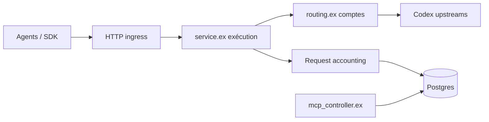

# icoretech/codex-pooler

> Self-hosted gateway that pools Codex accounts behind a stable API key, for teams and agents.

## The problem
Several agents or people share Codex accounts with quotas, keys and credentials that are hard to govern.

## What it actually does
A pool key stays fixed while the upstream accounts change. The service picks an eligible account (model, quota, health, session continuity), exposes OpenAI-compatible `/backend-api/codex` and `/v1`, and logs usage without storing prompts, files or tokens. Web console: pools, accounts, keys, invitations, limits, alerts, saved resets, usage dashboard, read-only MCP endpoint. Elixir/Phoenix backend with Postgres.

## How it is wired


## Trying it
```bash
git clone https://github.com/icoretech/codex-pooler.git
cd codex-pooler
export CODEX_POOLER_IMAGE_TAG=<release-tag>
scripts/self-host/generate-env.sh
docker compose pull
docker compose up -d
```
Then open `http://localhost:4000/bootstrap`.

## Cost and gotchas
Docker + Postgres. Upstream Codex accounts are at your expense; importing an `auth.json` can invalidate the other copy through token rotation. A license is present but not identified by GitHub. The model names in the README (gpt-6…) cannot be verified here.

## What it is not
Not a generic OpenAI proxy: unsupported routes fail on purpose. It gives the upstream no extra capacity: it spreads load across existing accounts.

## Alternatives
No alternative cited in the README.

## For you
Worth watching: interesting for governing access to coding agents in a team, but dependent on third-party accounts and a license to confirm.
