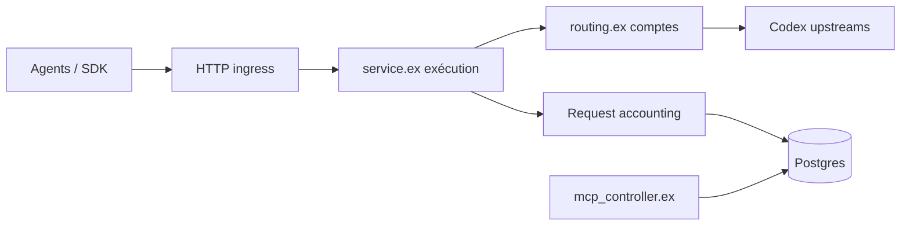

# icoretech/codex-pooler

> Passerelle auto-hébergée qui mutualise des comptes Codex derrière une clé d'API stable, pour équipes et agents.

## Le problème
Plusieurs agents ou personnes se partagent des comptes Codex avec des quotas, des clés et des identifiants difficiles à gouverner.

## Ce que ça fait vraiment
Une clé de pool reste fixe pendant que les comptes amont changent. Le service choisit un compte éligible (modèle, quota, santé, continuité de session), expose `/backend-api/codex` et `/v1` compatibles OpenAI, et journalise l'usage sans stocker prompts, fichiers ni jetons. Console web : pools, comptes, clés, invitations, limites, alertes, resets sauvegardés, tableau d'usage, endpoint MCP en lecture seule. Backend Elixir/Phoenix avec Postgres.

## Comment c'est branché


## Essayer
```bash
git clone https://github.com/icoretech/codex-pooler.git
cd codex-pooler
export CODEX_POOLER_IMAGE_TAG=<release-tag>
scripts/self-host/generate-env.sh
docker compose pull
docker compose up -d
```
Puis ouvrir `http://localhost:4000/bootstrap`.

## Coût et pièges
Docker + Postgres. Les comptes Codex amont sont à ta charge ; l'import d'un `auth.json` peut invalider l'autre copie par rotation de jeton. Licence présente mais non identifiée par GitHub. Les noms de modèles du README (gpt-6…) ne sont pas vérifiables ici.

## Ce que ce n'est pas
Pas un proxy OpenAI générique : les routes non prises en charge échouent volontairement. Il ne donne pas de capacité supplémentaire à l'amont : il répartit des comptes existants.

## Alternatives
Aucune alternative citée dans le README.

## Pour toi
À surveiller : intéressant pour gouverner l'accès à des agents de code en équipe, mais dépendant de comptes tiers et d'une licence à confirmer.

