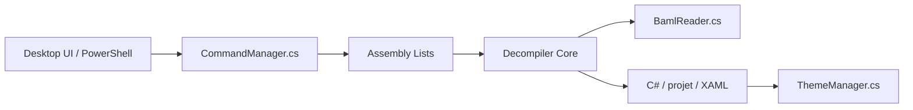

# icsharpcode/ILSpy

> Cross-platform .NET assembly decompiler and explorer, for C# developers.

## The problem
Reading the code of a .NET DLL or executable when you do not have the sources.

## What it actually does
Decompiles to C# (or a full project), navigates between types and methods, explores metadata, decodes BAML into XAML, handles ReadyToRun binaries. Avalonia interface (Windows, Linux, macOS), `ilspycmd` tool, PowerShell cmdlets, Visual Studio and VS Code extensions, NuGet packages to embed it.

## How it is wired


## Trying it
```bash
git submodule update --init --recursive
dotnet build ILSpy.Desktop.slnf
dotnet run --project ILSpy
```

## Cost and gotchas
Free. Building requires the .NET 10 SDK, and .NET 11 for the tests. Binaries are also published in releases.

## What it is not
Not a debugger. The README states no data collection or telemetry.

## Alternatives
No alternative named in the README.

## For you
Outside the .NET ecosystem, little use in data/AI; keep in mind only to inspect a .NET binary supplied by a third party.
