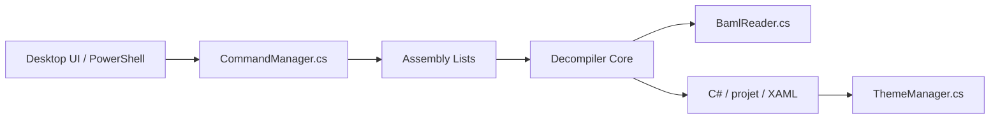

# icsharpcode/ILSpy

> Décompilateur et explorateur d'assemblages .NET multiplateforme, pour développeurs C#.

## Le problème
Lire le code d'une DLL ou d'un exécutable .NET dont on n'a pas les sources.

## Ce que ça fait vraiment
Décompile en C# (ou projet complet), navigue entre types et méthodes, explore les métadonnées, décode BAML en XAML, gère les binaires ReadyToRun. Interface Avalonia (Windows, Linux, macOS), outil `ilspycmd`, cmdlets PowerShell, extensions Visual Studio et VS Code, paquets NuGet pour l'embarquer.

## Comment c'est branché


## Essayer
```bash
git submodule update --init --recursive
dotnet build ILSpy.Desktop.slnf
dotnet run --project ILSpy
```

## Coût et pièges
Gratuit. Compiler demande le SDK .NET 10, et .NET 11 pour les tests. Les binaires sont aussi publiés en releases.

## Ce que ce n'est pas
Pas un débogueur. Le README annonce aucune collecte de données ni télémétrie.

## Alternatives
Aucune alternative nommée dans le README.

## Pour toi
Hors écosystème .NET, peu d'usage en data/IA ; à garder en tête seulement pour inspecter un binaire .NET fourni par un tiers.

