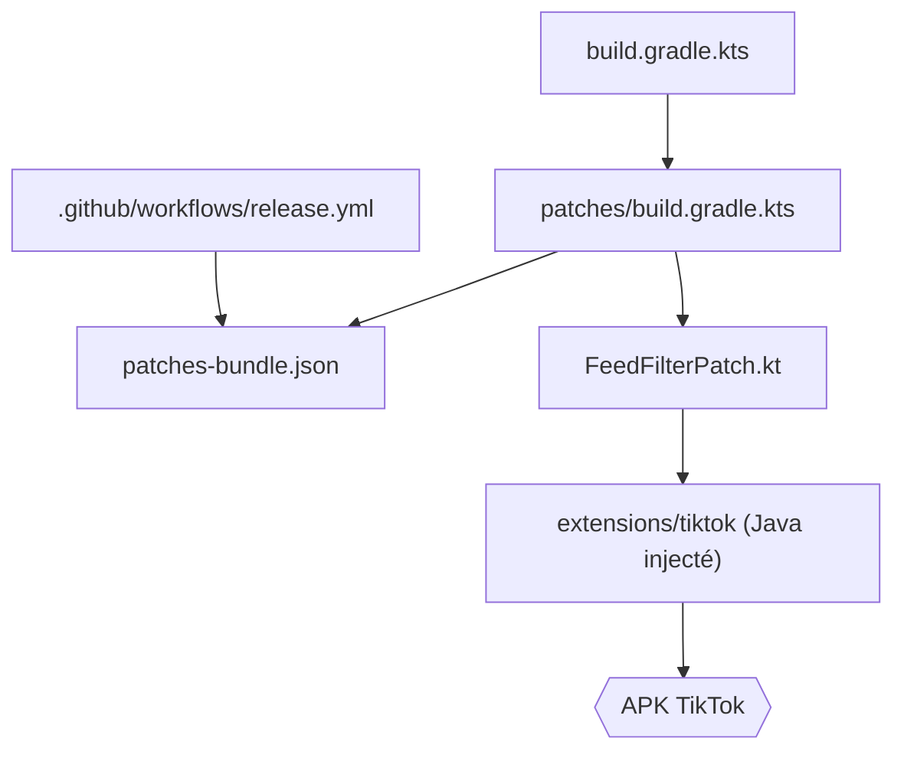

# icysymmetra/tiktok-patches-for-morphe

> Source of Morphe patches that modify the Android TikTok 46.2.3 application: filters, downloads, settings.

## The problem
The TikTok application imposes ads, mandatory login and few settings.

## What it actually does
A set of patches (about forty) injected into the APK: feed filter, watermark-free download, playback speed, hiding elements, share link cleanup, region spoofing, a "Feature Gate Lab" to override client-side flags. The patches target an exact TikTok version.

## How it is wired


## Trying it
```bash
./gradlew :patches:buildAndroid :patches:generatePatchesList
# Dans Morphe : ajouter la source https://github.com/icysymmetra/tiktok-patches-for-morphe
```

## Cost and gotchas
Requires the Morphe application and a TikTok APK of the right version. TikTok changes often: the patches will break. Overrides stay client-side. Not affiliated with TikTok.

## What it is not
Not a bypass of server-side blocks nor a VPN. May violate TikTok's terms of use.

## Alternatives
RookieEnough/De-Vanced: the project's cited base.

## For you
Ignore: modification of a consumer application, unrelated to your work and fragile by design.
