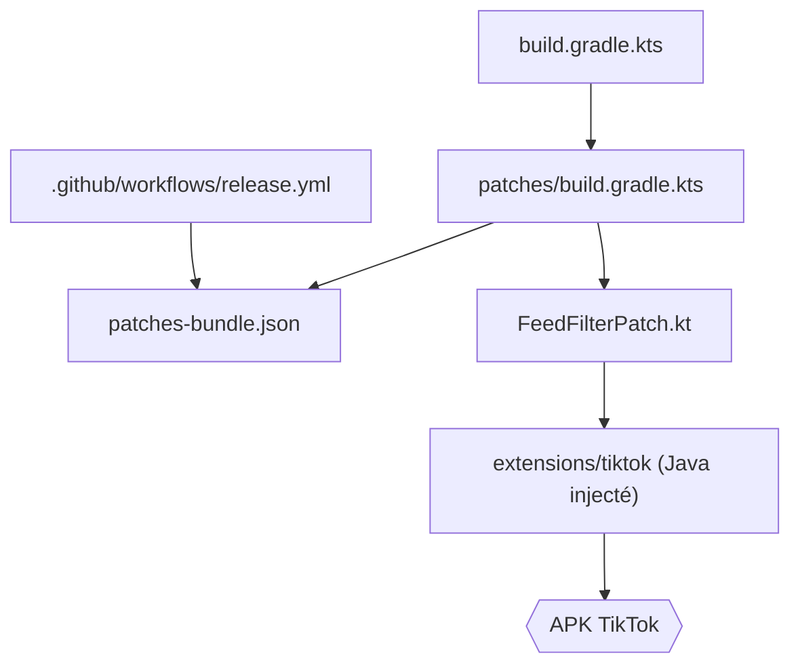

# icysymmetra/tiktok-patches-for-morphe

> Source de patches Morphe qui modifient l'application Android TikTok 46.2.3 : filtres, téléchargements, réglages.

## Le problème
L'application TikTok impose publicité, connexion obligatoire et peu de réglages.

## Ce que ça fait vraiment
Un jeu de patches (une quarantaine) injectés dans l'APK : filtre de fil, téléchargement sans filigrane, vitesse de lecture, masquage d'éléments, nettoyage des liens de partage, usurpation de région, un « Feature Gate Lab » pour surcharger des drapeaux côté client. Les patches ciblent une version exacte de TikTok.

## Comment c'est branché


## Essayer
```bash
./gradlew :patches:buildAndroid :patches:generatePatchesList
# Dans Morphe : ajouter la source https://github.com/icysymmetra/tiktok-patches-for-morphe
```

## Coût et pièges
Exige l'application Morphe et un APK TikTok de la bonne version. TikTok change souvent : les patches casseront. Les surcharges restent côté client. Non affilié à TikTok.

## Ce que ce n'est pas
Pas un contournement des blocages côté serveur ni un VPN. Peut contrevenir aux conditions d'utilisation de TikTok.

## Alternatives
RookieEnough/De-Vanced : base citée du projet.

## Pour toi
Ignorer : modification d'une application grand public, sans lien avec ton métier et fragile par construction.

