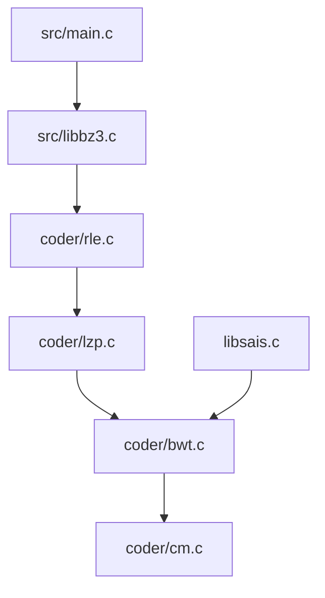

# iczelia/bzip3

> File compressor, successor to BZip2, designed to compress text and code better.

## The problem
bzip2 is slow and compresses less well than recent formats, especially on text and source code.

## What it actually does
Chain of RLE, LZP, Burrows-Wheeler transform (via libsais), then a context-mixing coder. The README gives a test on all Perl versions: 546 MB with bzip3 -b 511 versus 2,056 MB for xz, but with a lot of memory (12 to 18 GB). Multi-threaded, several architectures.

## How it is wired


## Trying it
```bash
./bootstrap.sh
./configure
make
sudo make install
brew install bzip3
```

## Cost and gotchas
Free. Large blocks = a lot of RAM. Performance depends heavily on the compiler. The README warns that data loss cannot be ruled out: do not use it as the only copy.

## What it is not
Not a universal format: you will need to install bzip3 to decompress. Not faster than zstd at decompression according to its own test.

## Alternatives
xz, bzip2, zstd, compared in the README; lrzip combined with bzip3 gives the best result in its test.

## For you
Worth watching: useful for archiving large text or code corpora if the RAM keeps up, otherwise zstd remains simpler.
