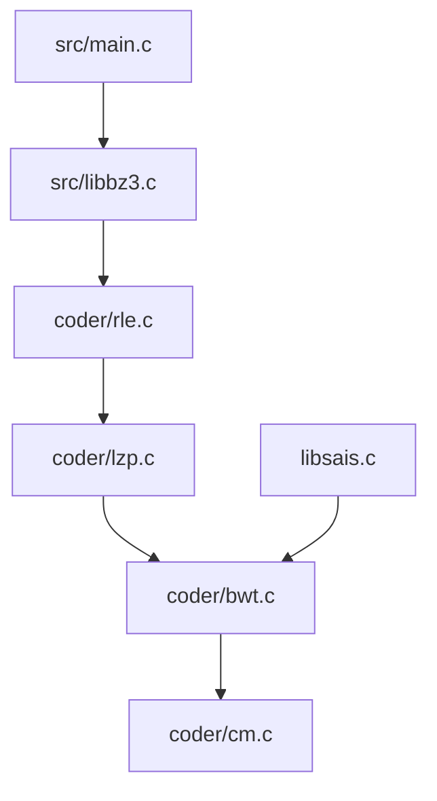

# iczelia/bzip3

> Compresseur de fichiers successeur de BZip2, pensé pour mieux compresser texte et code.

## Le problème
bzip2 est lent et compresse moins bien que les formats récents, surtout sur du texte et des sources.

## Ce que ça fait vraiment
Chaîne RLE, LZP, transformée de Burrows-Wheeler (via libsais) puis codeur à mélange de contextes. Le README donne un test sur toutes les versions de Perl : 546 Mo avec bzip3 -b 511 contre 2 056 Mo pour xz, mais avec beaucoup de mémoire (12 à 18 Go). Multi-thread, plusieurs architectures.

## Comment c'est branché


## Essayer
```bash
./bootstrap.sh
./configure
make
sudo make install
brew install bzip3
```

## Coût et pièges
Gratuit. Gros blocs = beaucoup de RAM. Performances très dépendantes du compilateur. Le README avertit qu'aucune perte de données n'est exclue : ne pas l'utiliser comme seule copie.

## Ce que ce n'est pas
Pas un format universel : tu devras installer bzip3 pour décompresser. Pas plus rapide que zstd en décompression selon son propre test.

## Alternatives
xz, bzip2, zstd, comparés dans le README ; lrzip combiné avec bzip3 donne le meilleur résultat de son test.

## Pour toi
Surveiller : utile pour archiver de gros corpus texte ou code si la RAM suit, sinon zstd reste plus simple.

