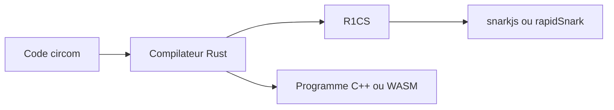

# iden3/circom

> Compiler for a language dedicated to arithmetic circuits for zero-knowledge proofs.

## The problem
Writing ZK circuit constraints by hand is tedious and hard to audit.

## What it actually does
- Template language with parameterizable templates, assembled into larger circuits.
- The compiler, written in Rust, produces an R1CS file and a program (C++ or WebAssembly) that computes the wire assignment.
- circomLib library: comparators, hash functions, signatures, converters.
- The proof systems live in snarkjs, wasmsnark and rapidSnark.
- circom 1 (JavaScript) is obsolete.

## How it is wired

## Trying it
No command documented in the README (it points to the Installation section of the docs).

## Cost and gotchas
Free. GPL-3.0 license: restrictive for proprietary code.

## What it is not
Not a complete proof system: you need a prover alongside it.

## Alternatives
circom 1 (obsolete); snarkjs, wasmsnark and rapidSnark are complements, not replacements.

## For you
Ignore unless you have a ZK proof project: outside the usual data / AI scope.
