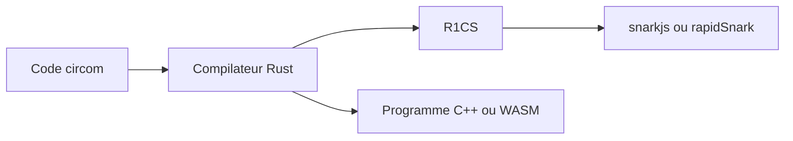

# iden3/circom

> Compilateur d'un langage dédié aux circuits arithmétiques pour preuves à divulgation nulle de connaissance.

## Le problème
Écrire à la main les contraintes d'un circuit ZK est fastidieux et difficile à auditer.

## Ce que ça fait vraiment
- Langage à gabarits (templates) paramétrables, assemblés en circuits plus grands.
- Le compilateur, écrit en Rust, produit un fichier R1CS et un programme (C++ ou WebAssembly) qui calcule l'affectation des fils.
- Bibliothèque circomLib : comparateurs, fonctions de hachage, signatures, convertisseurs.
- Les systèmes de preuve sont dans snarkjs, wasmsnark et rapidSnark.
- circom 1 (JavaScript) est obsolète.

## Comment c'est branché

## Essayer
Aucune commande documentée dans le README (renvoi à la section Installation de la doc).

## Coût et pièges
Gratuit. Licence GPL-3.0 : contraignante pour du code propriétaire.

## Ce que ce n'est pas
Pas un système de preuve complet : il faut un prouveur à côté.

## Alternatives
circom 1 (obsolète) ; snarkjs, wasmsnark et rapidSnark sont des compléments, pas des remplaçants.

## Pour toi
À ignorer sauf projet de preuves ZK : hors périmètre data / IA habituel.

