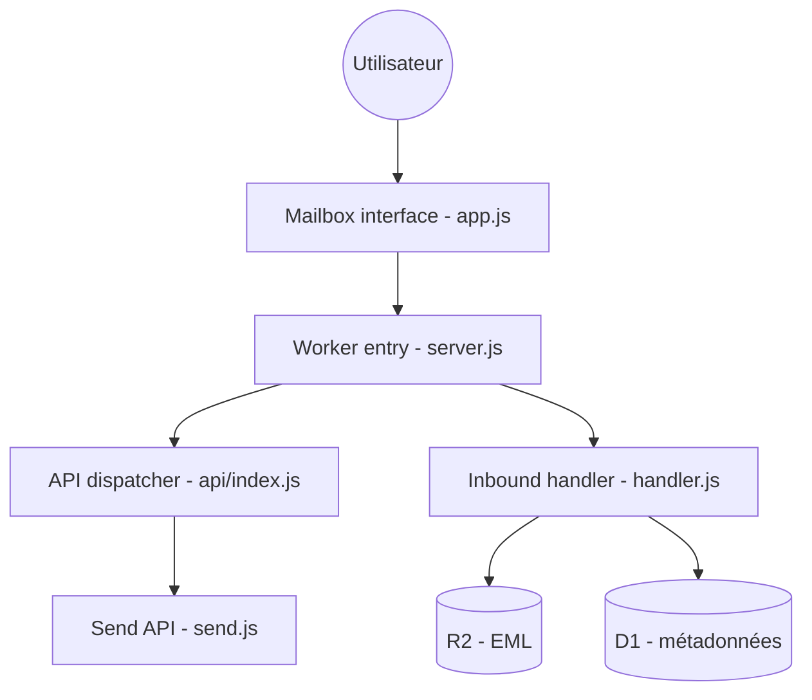

# idinging/freemail

> Temporary mailbox service on Cloudflare Workers, D1 and R2, with a REST API.

## The problem
Receiving a verification code or a disposable email without exposing your real address means running a service of your own.

## What it actually does
A Cloudflare Worker receives mail through Email Routing, parses it (code extraction), stores it as EML on R2 and metadata on D1. It creates mailboxes on the fly, manages users, forwards based on prefix rules and serves a light and dark web interface. Sending goes through Resend, SendFlare or Cyberpersons, routed by sender domain.

## How it is wired


## Trying it
```bash
npm install
npx wrangler d1 execute maill_free_db --local --file=./d1-init.sql
npx wrangler dev
```
Actually receiving mail requires deploying to Cloudflare.

## Cost and gotchas
Needs a Cloudflare account, a domain, D1 and R2 (free quotas are limited). Change `ADMIN_PASSWORD` and `JWT_TOKEN`. The README mentions a mailbox takeover vulnerability fixed in V5.3.2: check your version. The README also contains promotion of partner proxies.

## What it is not
Not a durable mail provider: disposable addresses, third-party senders. The public demo interface uses guest credentials.

## Alternatives
No alternative named in the README.

## For you
Ignore: a disposable-mailbox tool unrelated to data or models, and dependent on Cloudflare.
