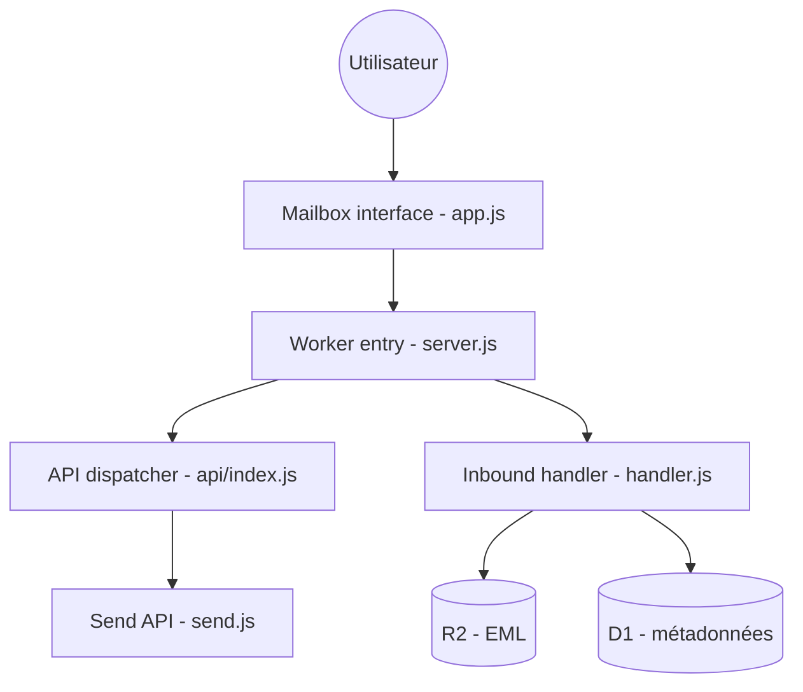

# idinging/freemail

> Service de boîtes mail temporaires sur Cloudflare Workers, D1 et R2, avec API REST.

## Le problème
Recevoir un code de vérification ou un mail jetable sans exposer sa vraie adresse demande un service à soi.

## Ce que ça fait vraiment
Un Worker Cloudflare reçoit les mails via Email Routing, les analyse (extraction de codes), les stocke en EML sur R2 et en métadonnées sur D1. Il crée les boîtes à la volée, gère des utilisateurs, transfère selon des règles de préfixe et sert une interface web claire et sombre. L'envoi passe par Resend, SendFlare ou Cyberpersons, routé par domaine d'expéditeur.

## Comment c'est branché


## Essayer
```bash
npm install
npx wrangler d1 execute maill_free_db --local --file=./d1-init.sql
npx wrangler dev
```
La réception réelle exige un déploiement sur Cloudflare.

## Coût et pièges
Compte Cloudflare, domaine, D1 et R2 (quotas gratuits limités). Modifier `ADMIN_PASSWORD` et `JWT_TOKEN`. Le README mentionne une faille de prise de contrôle de boîtes corrigée en V5.3.2 : vérifier la version. Le README contient aussi une promotion de proxys partenaires.

## Ce que ce n'est pas
Pas un fournisseur de mail durable : adresses jetables, expéditeurs tiers. L'interface de démonstration publique utilise des identifiants invités.

## Alternatives
Aucune alternative nommée dans le README.

## Pour toi
À ignorer : outil de boîtes jetables sans rapport avec la donnée ou les modèles, et dépendant de Cloudflare.

