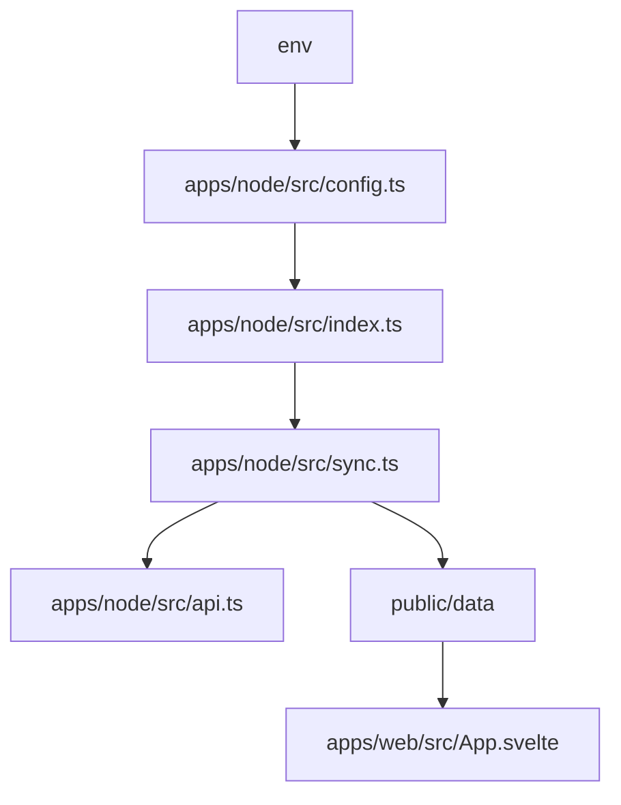

# idootop/mi-note-export

> Tool that backs up Xiaomi notes locally, with a static website, for Xiaomi cloud users.

## The problem
The Xiaomi cloud offers no bulk export of notes, and data may be erased after a long period of inactivity.

## What it actually does
A Docker container reads the Xiaomi account cookie, fetches notes and attachments via the Xiaomi API and writes them to `public/data`. A second container serves a small Svelte site to browse them, exportable as a static site. Private notes and tasks are not backed up.

## How it is wired


## Trying it
```bash
git clone https://github.com/idootop/mi-note-export.git && cd mi-note-export
docker run -it --rm --env-file $(pwd)/env -v $(pwd)/public/data:/app/public/data idootop/mi-note-sync:latest
docker run -it --rm --init -p 3000:3000 -v $(pwd)/public/data:/home/static/data idootop/mi-note-web:latest
```

## Cost and gotchas
Free. You need a Xiaomi account and its cookie in the `env` file, as well as Docker. The site gives access to all the notes: do not publish it on the Internet.

## What it is not
Not a complete export (private notes and tasks excluded) nor an official Xiaomi tool. The README is in Chinese.

## Alternatives
No alternative named in the README.

## For you
Ignore for your line of work; useful only if you need to recover your Xiaomi notes, with the risk of exposing your cookie.
