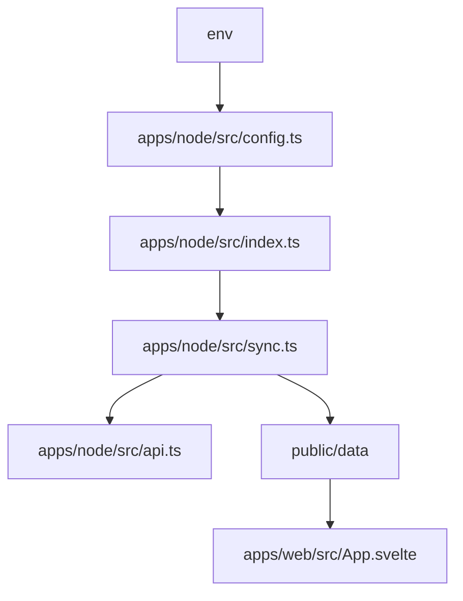

# idootop/mi-note-export

> Outil de sauvegarde des notes Xiaomi en local, avec site web statique, pour les utilisateurs du cloud Xiaomi.

## Le problème
Le cloud Xiaomi n'offre pas d'export en masse des notes, et les données peuvent être effacées après une longue inactivité.

## Ce que ça fait vraiment
Un conteneur Docker lit le cookie du compte Xiaomi, récupère notes et pièces jointes via l'API Xiaomi et les écrit dans `public/data`. Un second conteneur sert un petit site Svelte pour les consulter, exportable en site statique. Les notes privées et les tâches ne sont pas sauvegardées.

## Comment c'est branché


## Essayer
```bash
git clone https://github.com/idootop/mi-note-export.git && cd mi-note-export
docker run -it --rm --env-file $(pwd)/env -v $(pwd)/public/data:/app/public/data idootop/mi-note-sync:latest
docker run -it --rm --init -p 3000:3000 -v $(pwd)/public/data:/home/static/data idootop/mi-note-web:latest
```

## Coût et pièges
Gratuit. Il faut un compte Xiaomi et son cookie dans le fichier `env`, ainsi que Docker. Le site donne accès à toutes les notes : ne pas le publier sur Internet.

## Ce que ce n'est pas
Ce n'est pas un export complet (notes privées et tâches exclues) ni un outil officiel Xiaomi. Le README est en chinois.

## Alternatives
Aucune alternative nommée dans le README.

## Pour toi
À ignorer pour ton métier ; utile seulement si tu dois récupérer tes notes Xiaomi, avec le risque d'exposer ton cookie.

