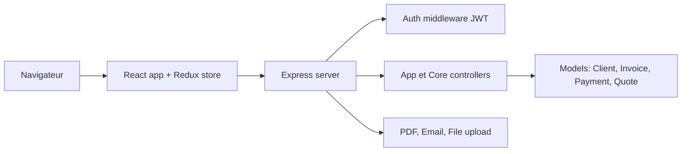

# idurar/idurar-erp-crm

> Open-source invoicing, quoting and payments ERP/CRM, built on the MERN stack.

## The problem
A small business wants to manage customers, quotes, invoices and payments without buying a commercial ERP.

## What it actually does
A React application (Ant Design, Redux) in front of an Express server with MongoDB. Modules cited: customers, quotes, invoices, payments, dashboard, settings. The architecture as described from the code adds JWT authentication, PDF generation, email and file upload. An "enterprise" cloud offering is pointed to at cloud.idurarapp.com.

## How it is wired

## Trying it
The README lists nine steps without giving any command: clone, create a MongoDB account and cluster, edit the environment file, update the MongoDB URI, install the back-end dependencies, run the setup script, start the back end, install and start the front end.

## Cost and gotchas
Free, but you need a MongoDB account. 483 open issues. The README talks about free commercial use and "fair-code" while the identified license is AGPL-3.0: check before any commercial use.

## What it is not
It is not a full ERP: the listed features are invoicing, quotes, payments, customers. The mentions of inventory and HR are not detailed.

## Alternatives
No alternative named in the README.

## For you
Ignore: a management application with no link to data or AI, under AGPL-3.0 with ambiguous licensing messaging.
