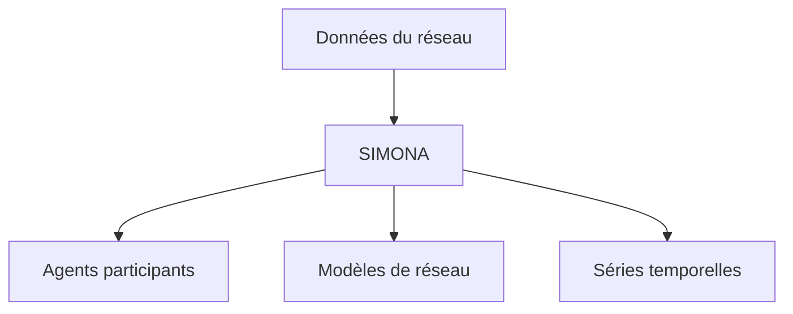

# ie3-institute/simona

> Multi-agent simulation environment for electrical distribution grids, for research and planning.

## The problem
Studying a distribution grid at large scale requires simulating many participants and pieces of equipment.

## What it actually does
Agent-based simulation toolbox for electrical grids. It generates realistic time series for grid participants and assets. Use cases mentioned: grid planning, flexibility, sector coupling. Ready-to-use models are provided. Installation and launch: referred to the documentation, not detailed here.

## How it is wired
Simplified diagram based on the fiche, no diagram provided.


## Trying it
```bash
# Aucune commande dans le README : voir la documentation du projet.
```

## Cost and gotchas
Free. The technical prerequisites (language, versions) are not given in the README; a research project asks you to cite the reference papers.

## What it is not
Not a machine-learning forecasting tool: an agent-based simulation. No quick start provided in the README.

## Alternatives
No alternative named in the README.

## For you
To ignore unless you work on electrical grid data: a highly specialized domain, unrelated to a generic AI pipeline.
