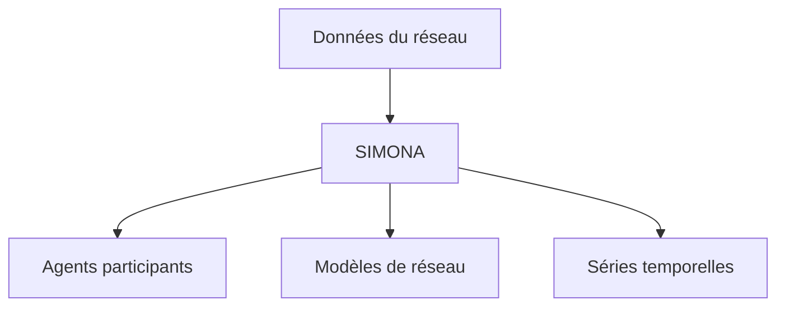

# ie3-institute/simona

> Environnement de simulation multi-agents de réseaux électriques de distribution, pour la recherche et la planification.

## Le problème
Étudier un réseau de distribution à grande échelle demande de simuler de nombreux participants et équipements.

## Ce que ça fait vraiment
Boîte à outils de simulation de réseaux électriques à base d'agents. Elle génère des séries temporelles réalistes pour les participants et actifs du réseau. Cas d'usage cités : planification de réseau, flexibilité, couplage entre secteurs. Des modèles prêts à l'emploi sont fournis. Installation et lancement : renvoyés à la documentation, non détaillés ici.

## Comment c'est branché
Schéma simplifié d'après la fiche, sans diagramme fourni.


## Essayer
```bash
# Aucune commande dans le README : voir la documentation du projet.
```

## Coût et pièges
Gratuit. Les prérequis techniques (langage, versions) ne sont pas indiqués dans le README ; un projet de recherche demande de citer les articles de référence.

## Ce que ce n'est pas
Pas un outil de prévision par apprentissage automatique : une simulation à base d'agents. Pas de démarrage rapide fourni dans le README.

## Alternatives
Aucune alternative nommée dans le README.

## Pour toi
À ignorer sauf si tu travailles sur des données de réseaux électriques : domaine très spécialisé, sans lien avec un pipeline IA générique.

