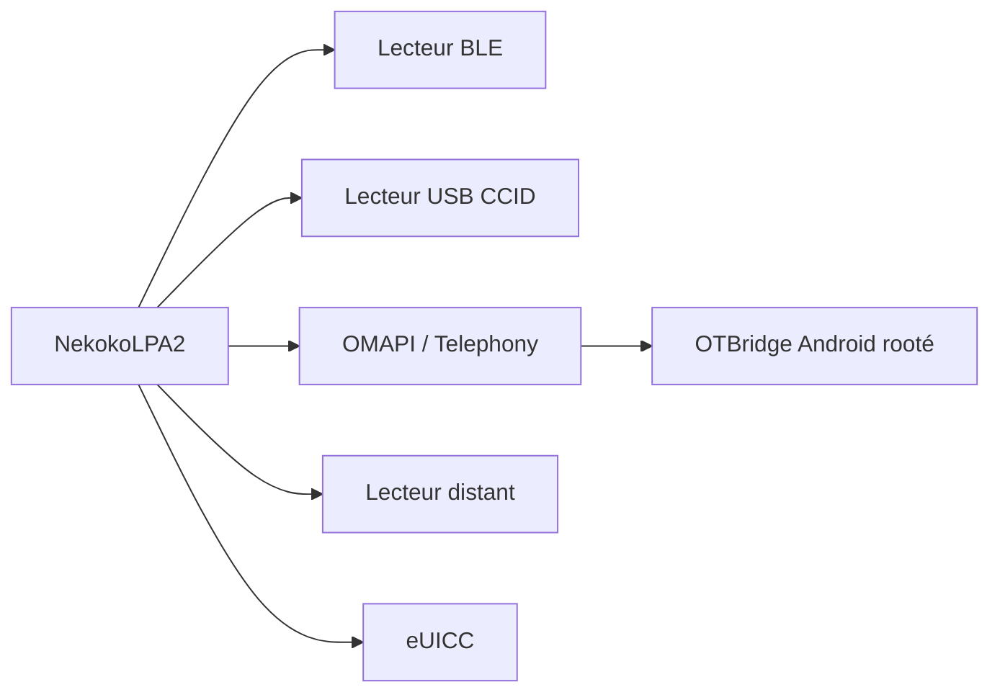

# iebb/NekokoLPA2

> Cross-platform eSIM management app for local eUICCs, external or remote readers.

## The problem
Carrier apps hide profile operations, the choice of transport and the visibility of the card.

## What it actually does
Manages eSIM profiles with BLE readers, USB CCID, OMAPI, Telephony, remote readers and WebUSB. Profile organization (icons, notes, tags) and expiry notifications. On rooted Android, the external provider OTBridge enables Telephony and bypasses OMAPI's ARA-M restrictions without giving the main app any privilege.

## How it is wired

## Trying it
No command: install through the App Store, Google Play, GitHub Releases or the web (web.lpa.ee).

## Cost and gotchas
Free. Bypassing ARA-M on a rooted phone exposes the phone; risk of losing an eSIM profile in case of error (not documented).

## What it is not
Not a carrier app: no plan purchase, it manages profiles you already own.

## Alternatives
No alternative named in the README.

## For you
Ignore: eSIM management unrelated to data or AI work, useful only to card tinkerers.
