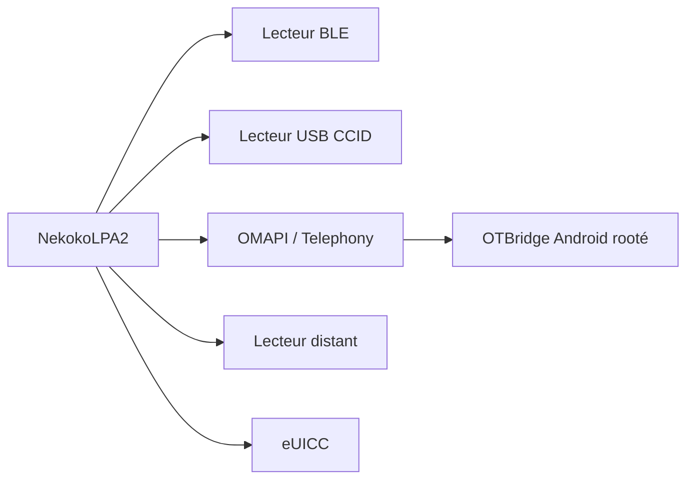

# iebb/NekokoLPA2

> Application multiplateforme de gestion d'eSIM pour eUICC locales, lecteurs externes ou distants.

## Le problème
Les applications d'opérateurs masquent les opérations de profil, le choix du transport et la visibilité de la carte.

## Ce que ça fait vraiment
Gère les profils eSIM avec des lecteurs BLE, USB CCID, OMAPI, Telephony, lecteurs distants et WebUSB. Organisation des profils (icônes, notes, étiquettes) et notifications d'expiration. Sur Android rooté, le fournisseur externe OTBridge active Telephony et contourne les restrictions ARA-M d'OMAPI sans privilège pour l'application principale.

## Comment c'est branché

## Essayer
Aucune commande : installation par l'App Store, Google Play, GitHub Releases ou le web (web.lpa.ee).

## Coût et pièges
Gratuit. Contourner ARA-M sur un téléphone rooté expose le téléphone ; risque de perte de profil eSIM en cas d'erreur (non documenté).

## Ce que ce n'est pas
Pas une application d'opérateur : pas d'achat de forfait, elle gère des profils que tu possèdes déjà.

## Alternatives
Aucune alternative nommée dans le README.

## Pour toi
À ignorer : gestion d'eSIM sans lien avec le travail data ou IA, utile seulement aux bidouilleurs de cartes.

