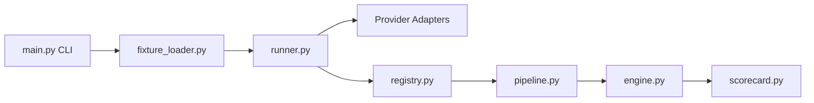

# ifixai-ai/iFixAi

> Audits an AI agent through adversarial, scored inspections with an independent judge, for AI teams.

## The problem
Classic evaluations measure latency or injections, not whether the agent does its job within the intended business and organizational frame.

## What it actually does
A CLI (or Claude Code/Codex plugin, or generated skill) loads a fixture, calls your agent's model or HTTP endpoint, has the responses judged by a second provider, then scores 60 inspections (A-F grade across five pillars, 28 "premium" inspections outside the grade). JSON + Markdown reports. A paid Pro version exists (audit service).

## How it is wired


## Trying it
```bash
pip install "ifixai[openai]"
ifixai setup
ifixai run
ifixai run --provider mock --api-key not-used --eval-mode self
```

## Cost and gotchas
Two keys from different providers for a citable grade; a full run is estimated at $10-18 of judge cost, with the tested agent billed separately. Pseudonymous telemetry enabled (can be disabled: `--no-telemetry`). The default fixture contains deliberate flaws.

## What it is not
Not a benchmark of model capabilities nor a regulatory audit: the full audit (400 inspections) is the paid Pro service.

## Alternatives
No alternative named in the README.

## For you
Interesting for evaluating a production agent with a cross judge, but young (created in April 2026): watch it before making it a CI gate.
